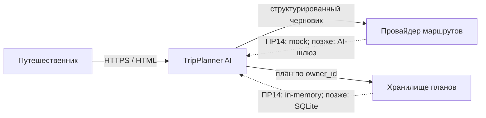
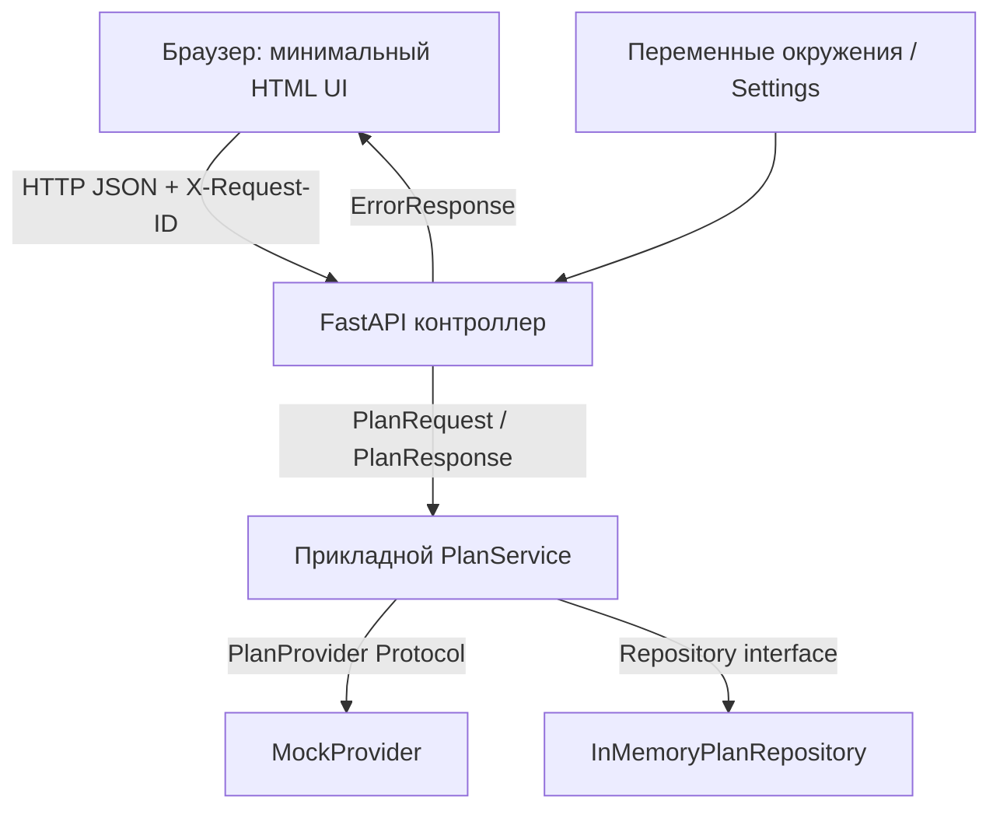

# Архитектура ПР14

На этом этапе выбран синхронный walking skeleton: запрос создания плана возвращает готовый результат одним HTTP-ответом. Фоновая очередь и SSE пока не реализованы; для mock-сценария они добавили бы инфраструктуру без пользовательской ценности. Решение пересматривается, когда измеренная длительность реального провайдера требует асинхронного сценария.

## Контекст

## Контейнеры и протоколы

**Направление зависимостей:** контроллер вызывает прикладной сервис; сервис зависит от контракта провайдера и хранилища; реализации провайдера и хранилища не импортируют веб-слой. Контроллер не импортирует SDK. В ПР14 сторонний SDK и реальная модель отсутствуют.

## Граница модель / код / человек

- **Модель/провайдер:** в текущем этапе только mock, создающий схематичный маршрут; реальная генерация появится в ПР15.
- **Код:** Pydantic-валидация входа/выхода, ограничения диапазона дат и бюджета, request ID, единый формат ошибок, изоляция планов по `X-Owner-ID`.
- **Человек:** задаёт ввод, проверяет и редактирует ориентировочный результат. UI явно предупреждает об отсутствии live-погоды, цен и часов работы.

## Хранилище и состояние этапов

| Компонент | Сейчас (ПР14) | Позже |
|---|---|---|
| Провайдер | детерминированный `MockProvider` | `recorded` и `openai_compat` |
| Хранилище | потокобезопасное in-memory | SQLite/дисковая реализация с тем же контрактом |
| Задачи | синхронный HTTP запрос | фоновые задачи и SSE при подтверждённой необходимости |
| Ошибки | закрытый кодовый каталог и единая JSON-обёртка | rate limits, retries, breaker и расширенная телеметрия |
| UI | простая доступная HTML-форма | состояния, отмена, восстановление и структурный редактор в ПР17 |

Исходник диаграмм: [docs/diagrams/architecture.mmd](diagrams/architecture.mmd).
