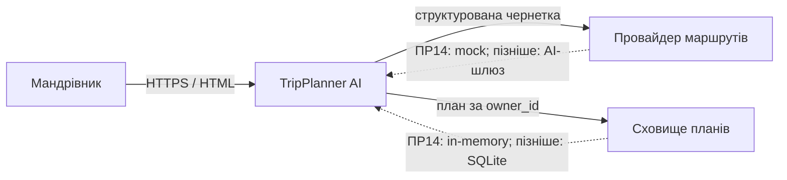
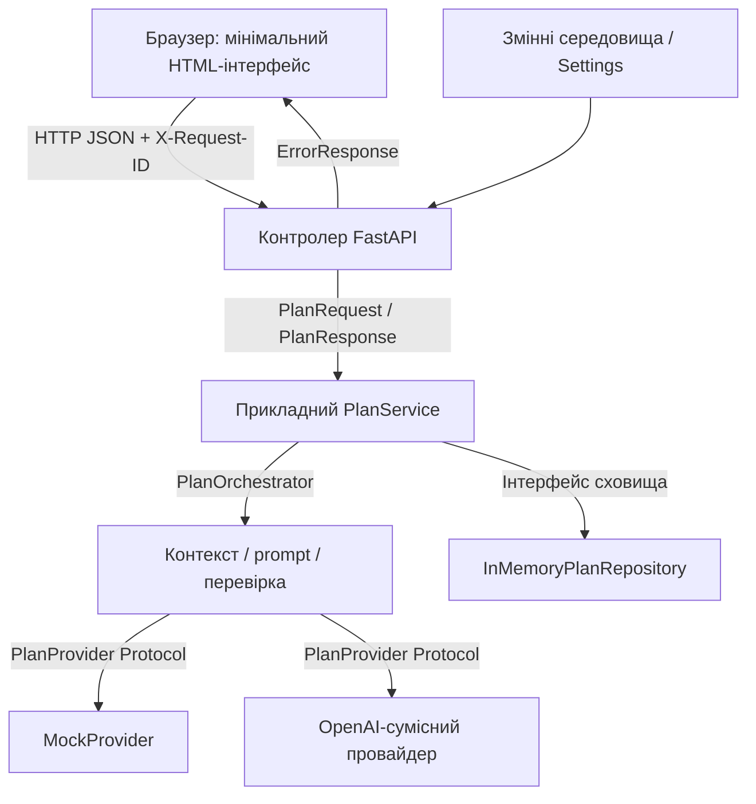

# Архітектура ПР14

На етапах ПР14–ПР15 обрано синхронний walking skeleton: запит на створення плану повертає готовий результат однією HTTP-відповіддю. Фонову чергу й SSE поки не реалізовано: для поточного сценарію вони додали б інфраструктуру без користі для користувача. Рішення буде переглянуто, коли виміряна тривалість реального запиту до провайдера вимагатиме асинхронного сценарію.

## Контекст

## Контейнери та протоколи

**Напрямок залежностей:** контролер викликає прикладний сервіс; сервіс залежить від контракту провайдера та сховища; реалізації провайдера й сховища не імпортують вебшар. Контролер не імпортує SDK. На ПР14 сторонній SDK і реальна модель відсутні.

## Межі між моделлю, кодом і людиною

- **Модель/провайдер:** на поточному етапі використовується лише mock, який створює схематичний маршрут; реальна генерація з’явиться на ПР15.
- **Код:** перевірка вхідних і вихідних даних через Pydantic, обмеження діапазону дат і бюджету, request ID, єдиний формат помилок, ізоляція планів за `X-Owner-ID`.
- **Людина:** вводить дані, перевіряє та редагує орієнтовний результат. Інтерфейс явно попереджає про відсутність актуальних даних щодо погоди, цін і годин роботи.

## Сховище та стан етапів

| Компонент | Зараз (ПР14) | Пізніше |
|---|---|---|
| Провайдер | `MockProvider`, `OpenAICompatProvider`, `RecordedProvider` | Інші сумісні провайдери |
| Сховище | Потокобезпечне сховище в пам’яті | Реалізація на SQLite/диску з тим самим контрактом |
| Завдання | Синхронний HTTP-запит | Фонові завдання та SSE за підтвердженої потреби |
| AI-оркестрація | prompt `plan-v1`, обмежений контекст, одна повторна спроба перевірки | Перевірка фактів за зовнішніми джерелами |
| Помилки | Закритий каталог кодів, єдиний JSON, денний AI-бюджет | Повторні спроби transient-помилок, breaker і розширена телеметрія на ПР18 |
| Інтерфейс | Проста доступна HTML-форма | Стани, скасування, відновлення та структурований редактор на ПР17 |

Початковий файл діаграм: [docs/diagrams/architecture.mmd](diagrams/architecture.mmd).
