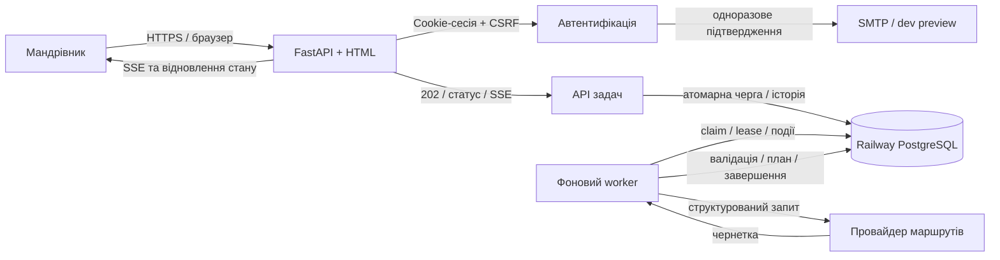
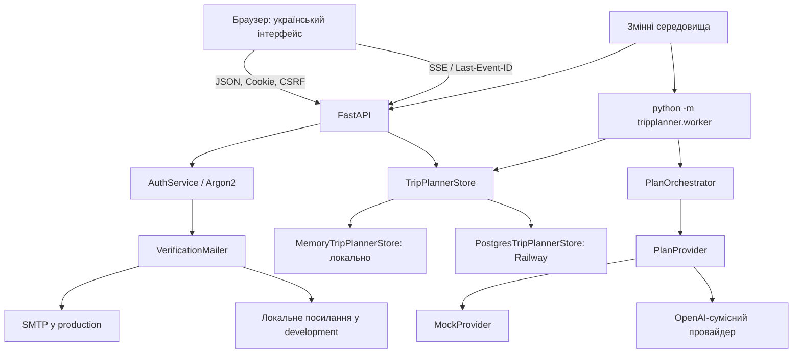

# Архітектура TripPlanner AI

## Контекст

TripPlanner створює структуровані чернетки маршрутів. Користувач входить, формує запит, отримує фактичні етапи обробки та повертається до збереженого результату. Сервіс не підтверджує актуальність погоди, цін і годин роботи без зовнішнього джерела.

Локально `STORAGE_BACKEND=memory` запускає worker у процесі вебзастосунку й використовується лише для демонстрації. У Railway вебзастосунок і окремий worker використовують спільний `DATABASE_URL`; тільки така конфігурація дає довговічні облікові записи, сесії, завдання, події й плани.

## Потік запиту

1. `AuthService` створює непідтверджений обліковий запис; одноразовий verification token зберігається лише як SHA-256-хеш і надсилається SMTP або показується в локальному development-режимі. Сесія створюється лише після підтвердження та успішного входу.
2. FastAPI перевіряє `PlanRequest`, генерує fingerprint і атомарно створює завдання за унікальністю `(user_id, idempotency_key)`.
3. Worker забирає чергу через `FOR UPDATE SKIP LOCKED`, записує lease та подію `preparing`.
4. Оркестратор повідомляє про генерацію та перевірку лише під час реального виконання цих фаз; текст моделі не віддається через SSE.
5. Транзакція зберігає план і переводить задачу в `completed`. Скасування синхронізується блокуванням рядка, тому пізній результат не перезаписує `cancelled`.
6. SSE читає журнал `job_events`, підтримує `Last-Event-ID`, heartbeat і перепідключення. API статусу є джерелом відновлення після оновлення сторінки.
7. Після втрати lease активна задача позначається `interrupted`, а не запускається повторно: повторний платний виклик без згоди користувача не виконується.

## Контейнери й протоколи

Контролер не імпортує SDK провайдера й не довіряє `X-Owner-ID`. PostgreSQL зберігає лише хеші сесійного bearer-токена й email verification token; запити власника обмежуються перевіреним `user_id`. CSRF-токен повертається тільки після входу або через same-origin endpoint `/auth/me` і потрібен для всіх автентифікованих змінювальних запитів.

## Межі та відомі обмеження

- Argon2, випадкові сесії, відкликання, CSRF/origin-перевірка та обмеження частоти входу реалізовані.
- Підтвердження пошти через SMTP, одноразові токени й локальний verification flow реалізовані. Відновлення пароля, видалення облікового запису й перевірка зовнішніх джерел залишаються обмеженнями; публічний сервіс також потребує перевірки SMTP-налаштувань та політик.
- Worker використовує lease й не повторює перервані задачі автоматично.
- Локальна in-memory база очищується після перезапуску; у production конфігурація вимагає PostgreSQL.
- Інтерфейс не показує штучні відсотки. Повідомлення етапу створюється лише фактичним кодом worker/orchestrator.
- Реальні інтеграційні тести з Railway PostgreSQL і браузерні автоматизовані e2e ще потребують середовища/налаштування; локальні API та ручний браузерний сценарій перевіряються окремо.

Початковий файл діаграм: [docs/diagrams/architecture.mmd](diagrams/architecture.mmd).
